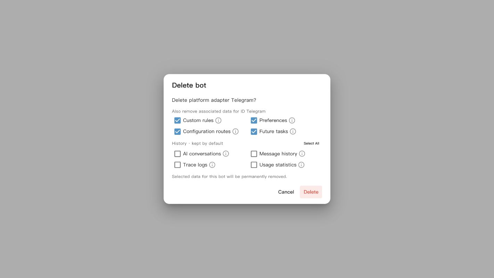

# Messaging Platforms

AstrBot supports integration with many mainstream instant messaging platforms, so you can use AstrBot on the IM platform your team already uses.

In WebUI, click **Bots** in the left sidebar to open the messaging platform integration page.  
Then click **Create Bot** in the top-right corner, choose the platform you want to connect, and follow the platform-specific guide in the left sidebar of this documentation.

If you are connecting NapCat QQ, choose the standalone `napcat` platform directly and follow the [NapCat](/en/platform/napcat) guide instead of the generic `OneBot v11` template.

When creating a bot, the built-in templates prioritize common integrations such as QQ Official Bot, OneBot v11, Personal WeChat, Lark, and WeCom. Hover over QQ Official Bot, OneBot v11, or Personal WeChat to see connection, capability, and QR-setup guidance. Plugins may add more templates, so the running WebUI remains the source of truth for the available list and its order.

## Current Built-in Adapters

The current code registers these built-in adapter types lazily. Plugins may register additional types, so the **Bots → Create Bot** list in your running WebUI remains authoritative.

| Integration                  | Adapter type                         | Guide                                                           |
| ---------------------------- | ------------------------------------ | --------------------------------------------------------------- |
| QQ Official Bot              | `qq_official`, `qq_official_webhook` | [QQ Official Bot](/en/platform/qqofficial)                      |
| OneBot v11 reverse WebSocket | `aiocqhttp`                          | [OneBot v11](/en/platform/aiocqhttp)                            |
| NapCat forward WebSocket     | `napcat`                             | [NapCat](/en/platform/napcat)                                   |
| Telegram                     | `telegram`                           | [Telegram](/en/platform/telegram)                               |
| WeCom application            | `wecom`                              | [WeCom](/en/platform/wecom)                                     |
| WeCom AI Bot                 | `wecom_ai_bot`                       | [WeCom AI Bot](/en/platform/wecom_ai_bot)                       |
| WeChat Official Account      | `weixin_official_account`            | [WeChat Official Account](/en/platform/weixin-official-account) |
| Personal WeChat              | `weixin_oc`                          | [Personal WeChat](/en/platform/weixin_oc)                       |
| Lark                         | `lark`                               | [Lark](/en/platform/lark)                                       |
| DingTalk                     | `dingtalk`                           | [DingTalk](/en/platform/dingtalk)                               |
| Slack                        | `slack`                              | [Slack](/en/platform/slack)                                     |
| Discord                      | `discord`                            | [Discord](/en/platform/discord)                                 |
| LINE                         | `line`                               | [LINE](/en/platform/line)                                       |
| Satori                       | `satori`                             | [Satori](/en/platform/satori/guide)                             |
| KOOK                         | `kook`                               | [KOOK](/en/platform/kook)                                       |
| Misskey                      | `misskey`                            | [Misskey](/en/platform/misskey)                                 |
| Mattermost                   | `mattermost`                         | [Mattermost](/en/platform/mattermost)                           |
| Built-in browser chat        | `webchat`                            | [WebUI and ChatUI](/en/use/webui)                               |

Community pages or plugin adapters are not part of this built-in registry. Check their repository, compatibility declaration, and permissions before installation.

> [!TIP]
> Install `ffmpeg` before deployment and ensure the build supports the media codecs required by your platform, including AMR where needed. This is especially important for WeChat-family adapters.

## Delete a bot and its associated data

Click the delete button in the bot list, then choose which data to remove in the confirmation dialog. Hover over or click the information icon next to an option to see what it removes.

- **Custom rules, Preferences, Configuration routes, and Future tasks** are selected by default. Preferences include the selected conversation, session variables, external service conversation IDs, adapter delivery mappings, and this bot's members in custom session groups. The groups themselves are kept.
- **AI conversations, Message history, Trace logs, and Usage statistics** are kept by default. Select them individually or use **Select all** in the history section.
- AI conversations contain model context; message history contains platform messages. Removing message history also removes the associated session names, aliases, and sender names. Trace logs refer to the local Trace store. Usage statistics removes this bot's model-call, token and response-timing records; message totals aggregated by adapter type are kept.

Selected data is permanently deleted. Shared configuration profiles, personas, knowledge bases, model providers, attachments, and plugin-managed data are kept. Only routing rules whose platform part exactly matches this bot's ID are removed; cross-platform wildcard rules are preserved. Selecting future tasks cancels this bot's schedules and deletes their records.

Canceling and reopening the dialog restores the default selections. If deletion fails, some selected data may already have been removed; the bot configuration is retained so you can check the logs and retry.
