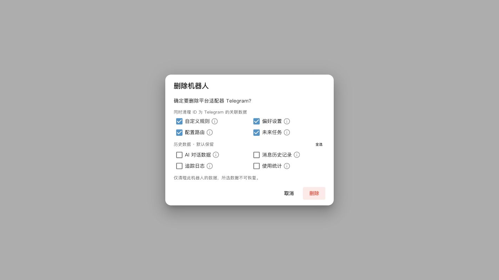

# 接入消息平台

AstrBot 支持接入众多主流即时通讯软件平台，帮助您在自己喜欢的 IM 平台上使用 AstrBot 的强大功能。

在 WebUI 中，点击侧边栏的**机器人**，即可进入消息平台接入界面。点击右上角的**创建机器人**，选择您想要接入的平台，按照本文档左侧提供的接入指南进行操作，即可完成接入。

如果你接入的是 NapCat QQ，请直接选择独立的 `napcat` 平台，并参考 [NapCat](/platform/napcat) 页面；不要再按通用 `OneBot v11` 模板配置。

创建机器人时，内置平台模板会优先显示 QQ 官方机器人、OneBot v11、个人微信、飞书和企业微信等常用接入方式。将鼠标悬停在 QQ 官方机器人、OneBot v11 或个人微信条目上，可以查看连接方式、权限限制和扫码配置提示。插件还可以追加平台模板，因此列表内容和顺序以运行中 WebUI 为准。

## 当前内置适配器

当前代码会按需注册下列内置适配器类型。插件还可以注册额外类型，因此请以运行中 WebUI 的 **机器人 → 创建机器人** 列表为最终依据。

| 接入方式                  | 适配器类型                           | 指南                                            |
| ------------------------- | ------------------------------------ | ----------------------------------------------- |
| QQ 官方机器人             | `qq_official`、`qq_official_webhook` | [QQ 官方机器人](/platform/qqofficial)           |
| OneBot v11 反向 WebSocket | `aiocqhttp`                          | [OneBot v11](/platform/aiocqhttp)               |
| NapCat 正向 WebSocket     | `napcat`                             | [NapCat](/platform/napcat)                      |
| Telegram                  | `telegram`                           | [Telegram](/platform/telegram)                  |
| 企业微信应用              | `wecom`                              | [企业微信](/platform/wecom)                     |
| 企业微信智能机器人        | `wecom_ai_bot`                       | [企业微信智能机器人](/platform/wecom_ai_bot)    |
| 微信公众号                | `weixin_official_account`            | [微信公众号](/platform/weixin-official-account) |
| 个人微信                  | `weixin_oc`                          | [个人微信](/platform/weixin_oc)                 |
| 飞书                      | `lark`                               | [飞书](/platform/lark)                          |
| 钉钉                      | `dingtalk`                           | [钉钉](/platform/dingtalk)                      |
| Slack                     | `slack`                              | [Slack](/platform/slack)                        |
| Discord                   | `discord`                            | [Discord](/platform/discord)                    |
| LINE                      | `line`                               | [LINE](/platform/line)                          |
| Satori                    | `satori`                             | [Satori](/platform/satori/guide)                |
| KOOK                      | `kook`                               | [KOOK](/platform/kook)                          |
| Misskey                   | `misskey`                            | [Misskey](/platform/misskey)                    |
| Mattermost                | `mattermost`                         | [Mattermost](/platform/mattermost)              |
| 内置浏览器聊天            | `webchat`                            | [WebUI 与 ChatUI](/use/webui)                   |

社区页面或插件适配器不属于这份内置注册表。安装前请核对其代码仓库、兼容性声明和权限需求。

> [!TIP]
> 建议在部署前预先安装 `ffmpeg`（并确保支持 `amr`），否则媒体类文件可能无法正常收发。对于微信类平台接入，强烈建议安装。

## 删除机器人与关联数据

点击机器人列表中的删除按钮，在确认窗口中选择要同时清理的数据。悬停或点击选项旁的信息图标，可查看每项的清理范围。

- 默认勾选 **自定义规则、偏好设置、配置路由、未来任务**。偏好设置包含当前对话选择、会话变量、外部服务会话 ID、适配器专用投递映射，以及自定义分组中的该机器人会话成员；分组本身保留。
- **AI 对话数据、消息历史记录、追踪日志、使用统计** 默认保留，可分别勾选，或点击历史数据区域的 **全选**。
- AI 对话数据是模型使用的上下文；消息历史记录是平台收发消息。删除消息历史时，也会清理对应的会话名称、别名和发送者名称。追踪日志仅指本地 Trace 存储。使用统计清理此机器人的模型调用、token 和响应耗时记录；按平台类型汇总的消息量保留。

只有选中的数据会被永久删除。共享的配置文件、人格、知识库、模型服务、附件及插件自建数据保留。配置路由只删除平台部分明确为该机器人 ID 的规则，跨平台通配规则保留。勾选未来任务会取消该机器人的调度并删除任务记录。

取消后重新打开窗口，会恢复默认选择。删除失败时，可能已有部分所选数据被清理；机器人配置会保留，便于检查日志后重试。
